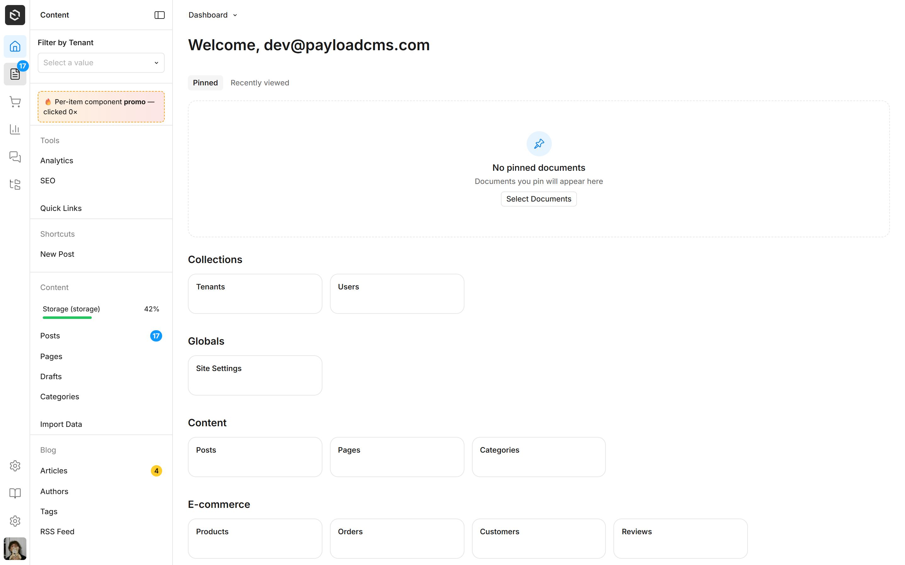
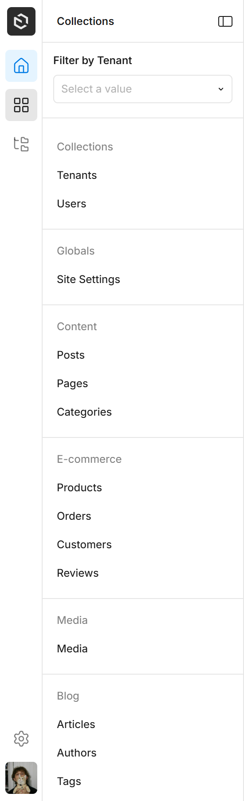

# Payload Enhanced Sidebar

> [!IMPORTANT]
> **This is the Payload v4 branch.** It targets Payload `4.0.0-beta` and is released under the `beta` tag (`pnpm add @veiag/payload-enhanced-sidebar@beta`). The Payload v3 version lives on `main` and is released as `latest`.
>
> Coming from the v3 version? Read the [v4 migration guide](docs/migration-v4.md).
>
> Found a problem with the v4 version? Please [open an issue](https://github.com/VeiaG/payload-enhanced-sidebar/issues/new?labels=v4-beta) with the **`v4-beta`** label.

An enhanced sidebar plugin for [Payload CMS](https://payloadcms.com) that adds a tabbed navigation system to organize collections and globals into logical groups.

## Features

- **Tabbed Navigation** - Organize collections into separate tabs for cleaner navigation
- **Vertical Tab Bar** - Icon-based tabs on the left side of the sidebar
- **Link Support** - Add navigation links (like Dashboard) alongside tabs, or give a tab its own `href` so it navigates *and* opens its panel
- **Custom Items** - Add custom navigation items that can be merged into existing groups
- **Badges** - Show notification badges on tabs and navigation items (API-based or reactive provider)
- **Custom Components** - Replace any part of the sidebar with your own React components
- **i18n Support** - Full localization support for labels and groups
- **Lucide Icons** - Use any [Lucide icon](https://lucide.dev/icons) for tabs and links, or provide a custom icon component per tab
- **Payload's own sidebar tabs** - Folder/tag trees and other native tabs, grouped in one **Browse** tab (Payload v4)
- **Account menu and logo** - Payload's account menu as an avatar at the bottom of the bar, your brand icon at the top



## Installation

```bash
npm install @veiag/payload-enhanced-sidebar
# or
yarn add @veiag/payload-enhanced-sidebar
# or
pnpm add @veiag/payload-enhanced-sidebar
```

For Payload v4 (beta), install the `beta` tag — the `latest` version supports Payload v3:

```bash
pnpm add @veiag/payload-enhanced-sidebar@beta
```

## Quick Start

```typescript
import { payloadEnhancedSidebar } from '@veiag/payload-enhanced-sidebar'
import { buildConfig } from 'payload'

export default buildConfig({
  // ... your config
  plugins: [
    payloadEnhancedSidebar({
      // Works with defaults!
    }),
  ],
})
```

This will add:
- Your brand icon at the top (`admin.components.graphics.Icon`, or the Payload icon)
- A Dashboard link and a default tab showing all collections and globals
- A **Browse** tab with Payload's own sidebar tabs (folder/tag trees), when you have any
- The account menu at the bottom (avatar → profile, theme, language, settings, log out)



## Documentation

- **[Configuration](docs/configuration.md)** — tabs, links, custom items, ordering, and every option (`nativeTabs`, `logo`, `userMenu`, `iconStrokeWidth`, …)
- **[Badges](docs/badges.md)** — counts on tabs and nav items: collection counts, API, or your own provider
- **[Access control](docs/access-control.md)** — hide tabs, links and items per user
- **[Custom components](docs/custom-components.md)** — replace any part of the sidebar, lazy tabs, hooks and default building blocks
- **[Migrating to Payload v4](docs/migration-v4.md)** — what changes in the plugin on Payload v4

## Payload Features Support

- **Sidebar tabs** - Payload's `admin.components.sidebar.tabs`, including the folder/tag tree tabs added for `folders` / `tags` / `hierarchy` collections (see [`nativeTabs`](docs/configuration.md#nativetabs))
- **Account menu** - Payload's account menu, with `admin.avatar` and `admin.components.userMenuSettingsItems`, `admin.components.logout.Button` (see [`userMenu`](docs/configuration.md#usermenu))
- **Brand icon** - `admin.components.graphics.Icon`, which Payload v4 no longer shows in the admin (see [`logo`](docs/configuration.md#logo))
- **Settings Menu Items** - `admin.components.settingsMenu`, behind the gear button
- **Nav slots** - `admin.components.beforeNav`, `beforeNavLinks`, `afterNavLinks` and `afterNav`, rendered inside the nav content area — `beforeNav` before `beforeNavLinks`, `afterNav` after `afterNavLinks`. Content made for Payload's nav (like the multi-tenant selector) gets the same `--nav-padding-*` variables
- **Embedded admin** - In Payload's embedded mode the close button and account menu are hidden, as in Payload's own nav

## Contributing

Contributions are welcome! Please feel free to submit a Pull Request.

1. Fork the repository
2. Create your feature branch (`git checkout -b feature/amazing-feature`)
3. Commit your changes (`git commit -m 'Add some amazing feature'`)
4. Push to the branch (`git push origin feature/amazing-feature`)
5. Open a Pull Request

## Issues

Found a bug or have a feature request? Please open an issue on [GitHub](https://github.com/VeiaG/payload-enhanced-sidebar/issues). For the Payload v4 version, add the **`v4-beta`** label.

## License

MIT © [VeiaG](https://github.com/VeiaG)

## Links

- [GitHub Repository](https://github.com/VeiaG/payload-enhanced-sidebar)
- [Payload CMS](https://payloadcms.com)
- [Lucide Icons](https://lucide.dev/icons)

---

### More plugins and Payload resources at [PayloadCMS Extensions](https://payload.veiag.dev/)
