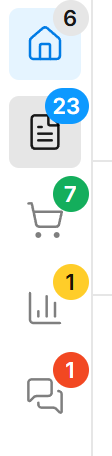

# Badges

Badges allow you to show notification counts on tabs and navigation items. There are three ways to configure badges:

<!-- [screenshot - Badges showcase: show sidebar with multiple badges - on tab icon (red "5"), on nav item (blue "12"), maybe one with "99+". Show different colors: error (red), primary (blue), warning (yellow)] -->

## Badge on Tabs/Links

Add a `badge` property to any tab or link in the `tabs` array:

```typescript
tabs: [
  {
    id: 'orders',
    type: 'tab',
    icon: 'ShoppingCart',
    label: 'Orders',
    collections: ['orders'],
    // Badge on the tab icon
    badge: {
      type: 'collection-count',
      collectionSlug: 'orders',
      color: 'error',
    },
  },
]
```

## Badges on Navigation Items

Use the `badges` configuration to add badges to any sidebar item (collections, globals, or custom items):

```typescript
payloadEnhancedSidebar({
  badges: {
    // Show document count for posts collection
    posts: { type: 'collection-count', color: 'primary' },
    // Custom API endpoint
    orders: {
      type: 'api',
      endpoint: '/api/orders/pending',
      responseKey: 'count',
      color: 'error',
    },
    // Provider-based (reactive)
    notifications: { type: 'provider', color: 'warning' },
  },
})
```

## Badge Types

### `collection-count`

Automatically fetches document count from a collection.

```typescript
{
  type: 'collection-count',
  collectionSlug?: string,  // Defaults to item's slug
  color?: BadgeColor,       // 'default' | 'primary' | 'success' | 'warning' | 'error'
  where?: object,           // Optional filter query
}
```

### `api`

Fetches badge value from a custom API endpoint.

```typescript
{
  type: 'api',
  endpoint: string,         // API URL (relative or absolute)
  method?: 'GET' | 'POST',  // Default: 'GET'
  responseKey?: string,     // Key to extract from response. Default: 'count'
  color?: BadgeColor,
}
```

### `provider`

Uses reactive values from `BadgeProvider` context. Values update automatically when the provider changes.

```typescript
{
  type: 'provider',
  slug?: string,            // Key in provider values. Defaults to item's slug/id
  color?: BadgeColor,
}
```

## Using BadgeProvider

For reactive badges (real-time updates, websockets, etc.), use the `BadgeProvider`:

1. Create a provider component:

```typescript
// components/MyBadgeProvider.tsx
'use client'

import { BadgeProvider } from '@veiag/payload-enhanced-sidebar/client'
import { useEffect, useState } from 'react'

export const MyBadgeProvider = ({ children }) => {
  const [counts, setCounts] = useState({
    orders: 0,
    notifications: 0,
  })

  useEffect(() => {
    // Fetch initial counts, subscribe to websocket, etc.
    const ws = new WebSocket('wss://your-api/counts')
    ws.onmessage = (e) => setCounts(JSON.parse(e.data))
    return () => ws.close()
  }, [])

  return <BadgeProvider values={counts}>{children}</BadgeProvider>
}
```

2. Add it to Payload's providers:

```typescript
// payload.config.ts
export default buildConfig({
  admin: {
    components: {
      providers: ['./components/MyBadgeProvider#MyBadgeProvider'],
    },
  },
})
```

3. Configure badges to use the provider:

```typescript
payloadEnhancedSidebar({
  badges: {
    orders: { type: 'provider', color: 'error' },
  },
  tabs: [
    {
      id: 'notifications',
      type: 'link',
      href: '/notifications',
      icon: 'Bell',
      label: 'Notifications',
      badge: { type: 'provider', slug: 'notifications', color: 'warning' },
    },
  ],
})
```

## Badge Colors

Available colors: `default`, `primary`, `success`, `warning`, `error`



## Badge Display

- Numbers up to 99 are shown as-is
- Numbers > 99 are shown as "99+"
- Zero or undefined values hide the badge
- Provider values can also be React nodes for custom rendering
