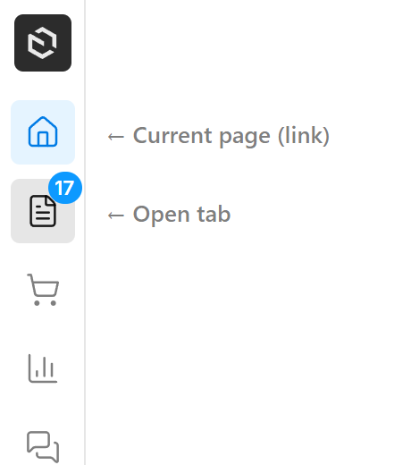

# Configuration

## Full Configuration Example

```typescript
import { payloadEnhancedSidebar } from '@veiag/payload-enhanced-sidebar'
import { buildConfig } from 'payload'

export default buildConfig({
  plugins: [
    payloadEnhancedSidebar({
      // Tabs and links in the sidebar
      tabs: [
        // Dashboard link
        {
          id: 'dashboard',
          type: 'link',
          href: '/',
          icon: 'House',
          label: { en: 'Dashboard', uk: 'Головна' },
        },
        // Content tab - shows specific collections
        {
          id: 'content',
          type: 'tab',
          icon: 'FileText',
          label: { en: 'Content', uk: 'Контент' },
          collections: ['posts', 'pages', 'categories'],
        },
        // Link to external documentation
        {
          id: 'docs',
          type: 'link',
          href: 'https://payloadcms.com/',
          icon: 'BookOpen',
          isExternal: true,
          label: { en: 'Documentation', uk: 'Документація' },
        },
        // E-commerce tab with custom items
        {
          id: 'ecommerce',
          type: 'tab',
          icon: 'ShoppingCart',
          label: { en: 'E-commerce', uk: 'E-commerce' },
          collections: ['products', 'orders', 'customers'],
          customItems: [
            {
              slug: 'analytics',
              href: '/analytics',
              label: { en: 'Analytics', uk: 'Аналітика' },
              group: 'E-commerce', // Merge into existing group
            },
            {
              slug: 'quick-add',
              href: '/quick-add',
              label: { en: 'Quick Add', uk: 'Швидке додавання' },
              position: 'top', // Appears above all collection groups
            },
          ],
        },
        // Settings tab with globals
        {
          id: 'settings',
          type: 'tab',
          icon: 'Settings',
          label: { en: 'Settings', uk: 'Налаштування' },
          collections: ['users'],
          globals: ['site-settings', 'footer-settings'],
          customItems: [
            {
              slug: 'api-keys',
              href: '/api-keys',
              label: { en: 'API Keys', uk: 'API Ключі' },
              // No group - will appear at the bottom
            },
            {
              slug:'external-link',
              href: 'https://example.com',
              isExternal: true,
              label: { en: 'External Link', uk: 'Зовнішнє Посилання'}
            }
          ],
        },
      ],

      // Separate logout button in the tabs bar (default: false — the account menu has log out)
      showLogout: false,

      // Disable the plugin
      disabled: false,
    }),
  ],
})
```

## `tabs`

Array of tabs and links to show in the sidebar.

**Tab (`type: 'tab'`)**

| Property | Type | Required | Description |
|----------|------|----------|-------------|
| `id` | `string` | Yes | Unique identifier |
| `type` | `'tab'` | Yes | Tab type |
| `icon` | `IconName` | Yes* | Lucide icon name |
| `iconComponent` | `SidebarComponent` | Yes* | Path to a custom icon component (string or `{ path, clientProps }`) |
| `buttonComponent` | `SidebarComponent` | No | Custom button for this item only — overrides `customComponents.TabButton` (see [docs](custom-components.md#buttoncomponent-per-item-button)) |
| `label` | `LocalizedString` | Yes | Tab tooltip/label |
| `collections` | `CollectionSlug[]` | No | Collections to show in this tab |
| `globals` | `GlobalSlug[]` | No | Globals to show in this tab |
| `customItems` | `SidebarTabItem[]` | No | Custom navigation items (see below) |
| `contentComponent` | `SidebarComponent` | No | Replaces the whole nav area while this tab is active — e.g. a chat list (see [docs](custom-components.md#contentcomponent-per-tab-content)) |
| `lazy` | `boolean` | No | Render `contentComponent` on demand, when the tab is opened, instead of on every page load (see [docs](custom-components.md#lazy-rendering-lazy-true)) |
| `badge` | `BadgeConfig` | No | Badge configuration for the tab icon |
| `href` | `string` | No | Makes the tab navigate as well as open its panel. Relative to the admin route (see below) |
| `position` | `'top' \| 'bottom'` | No | `'bottom'` pins the tab to the bottom of the bar, above the actions (default `'top'`) |
| `access` | `TabAccessFunction` | No | Server-side access control — return `false` to hide |

> \* Exactly one of `icon` or `iconComponent` is required — they are mutually exclusive.
> If neither `collections` nor `globals` is specified, the tab shows all collections and globals (except tabs with a `contentComponent`). Once either is set, only the listed slugs are shown — pass `collections: []` / `globals: []` to show none.

**Tabs that are also links (`href` on a tab)**

By default a `tab` opens a panel and a `link` navigates — one or the other. Give a tab an `href` and it does both: a click navigates **and** opens the tab's panel, so its child items stay visible. This is what you want for a Dashboard tab that should open `/admin` while still showing its own shortcuts.

```typescript
tabs: [
  {
    id: 'dashboard',
    type: 'tab',
    href: '/',                 // relative to the admin route → /admin
    icon: 'House',
    label: 'Dashboard',
    customItems: [
      { slug: 'new-post', href: '/collections/posts/create', label: 'New Post' },
    ],
  },
]
```

Click behavior:

| Click | Result |
|-------|--------|
| Plain left-click | Navigates to `href` **and** opens the tab's panel |
| ⌘ / Ctrl / Shift / Alt click, middle-click | Navigates only — a click that lands in a new tab/window leaves the current window's panel exactly as it was |

A tab's `href` is always relative to the admin route — there is no `isExternal` here. An external href opens in a new browser tab, which would leave this window untouched and the tab's panel unreachable. Use `type: 'link'` for external destinations.

The tab renders as a real anchor, so "Open in new tab", link previews and keyboard activation all work as expected.

Such a tab shows two independent states: the background highlight marks the **open panel**, while the left-edge bar marks the **current route** — so it stays visible as the active panel even after you navigate away.


**Link (`type: 'link'`)**

| Property | Type | Required | Description |
|----------|------|----------|-------------|
| `id` | `string` | Yes | Unique identifier |
| `type` | `'link'` | Yes | Link type |
| `icon` | `IconName` | Yes* | Lucide icon name |
| `iconComponent` | `SidebarComponent` | Yes* | Path to a custom icon component (string or `{ path, clientProps }`) |
| `buttonComponent` | `SidebarComponent` | No | Custom button for this item only — overrides `customComponents.TabButton` (see [docs](custom-components.md#buttoncomponent-per-item-button)) |
| `label` | `LocalizedString` | Yes | Link tooltip/label |
| `href` | `string` | Yes | URL |
| `isExternal` | `boolean` | No | If true, `href` is absolute URL, if not, `href` is relative to admin route |
| `badge` | `BadgeConfig` | No | Badge configuration for the link icon |
| `position` | `'top' \| 'bottom'` | No | `'bottom'` pins the link to the bottom of the bar, above the actions (default `'top'`) |
| `access` | `TabAccessFunction` | No | Server-side access control — return `false` to hide |

> \* Exactly one of `icon` or `iconComponent` is required — they are mutually exclusive.

**Custom slot (`type: 'custom'`)**

Renders an arbitrary component in the tabs bar — useful for spacers, separators, decorative elements, etc. Does not open any navigation content.

| Property | Type | Required | Description |
|----------|------|----------|-------------|
| `id` | `string` | Yes | Unique identifier |
| `type` | `'custom'` | Yes | Custom slot type |
| `component` | `SidebarComponent` | Yes | Component to render (string path or `{ path, clientProps }`) |
| `position` | `'top' \| 'bottom'` | No | `'bottom'` pins the slot to the bottom of the bar, above the actions (default `'top'`) |
| `access` | `TabAccessFunction` | No | Server-side access control — return `false` to hide |

The component receives `{ id }` plus any `clientProps` you pass. See [Custom Components](custom-components.md) for details.

```typescript
{
  id: 'separator',
  type: 'custom',
  component: './components/Sidebar#TabSeparator',
}
```



**Tab bar position (`position`)**

Any tab, link, or custom slot can be pinned to the bottom of the tabs bar with `position: 'bottom'`. Bottom items render in config order, just **above** the actions area (settings / account menu). Items default to `'top'`.

```typescript
tabs: [
  { id: 'dashboard', type: 'link', href: '/', icon: 'House', label: 'Dashboard' },
  { id: 'content', type: 'tab', icon: 'FileText', label: 'Content', collections: ['posts'] },
  // pinned to the bottom, above the settings button and the account menu
  { id: 'settings', type: 'tab', icon: 'Settings', label: 'Settings', globals: ['site-settings'], position: 'bottom' },
]
```

> The tab bar is not virtualized/scrolled — if you have a very large number of top tabs they may collide with the bottom group. `position` is intended for a small number of pinned items (settings, help, etc.).

## `customItems`

Custom items can be added to any tab:

```typescript
{
  slug: 'unique-slug',           // Required: unique identifier
  href: '/path',                 // Required: URL
  label: { en: 'Label' },        // Required: display label
  group: { en: 'Group Name' },   // Optional: merge into existing group or create new
  isExternal: true,              // Optional: if true, href is absolute URL
  position: 'top',               // Optional: 'top' | 'bottom' (default: 'bottom')
}
```

**Group behavior:**
- If `group` matches an existing collection group label, the item is added to that group
- If `group` doesn't match any existing group, a new group is created
- If `group` is not specified, the item appears as ungrouped

**Position behavior:**
- `position: 'top'` — item (or new custom group) appears **above** all collection/global groups
- `position: 'bottom'` — appears below all groups (default)
- Has no effect on items that merge into an existing collection group via `group`

**Custom component item:**

Instead of `href`/`label`, a custom item can render your own component (`slug` + `component`). It renders in the nav row via Payload's component system — both server and client components are supported — and honors the same `group`/`position` rules.

```typescript
{
  slug: 'storage-meter',                       // Required: unique identifier
  component: './components/Sidebar#StorageMeter', // Required: string path or { path, clientProps }
  position: 'top',                             // Optional
  group: 'Content',                            // Optional
}
```

The component receives `CustomNavItemComponentProps` (`{ slug }`) plus any `clientProps`. See [Custom Components](custom-components.md#per-item-custom-component-customitemscomponent) for details.


## Ordering groups and items (`sort`)

By default, groups and items follow Payload's default order plus your `customItems` `position`/`group` rules. The `sort` option lets you take **full control of the order** per tab, without changing that default for tabs you don't configure.

`sort` is keyed by tab `id`. Each entry has two optional functions that return a **sort key** (`number | string | undefined`):

```typescript
payloadEnhancedSidebar({
  tabs: [
    { id: 'shop', type: 'tab', icon: 'ShoppingCart', label: 'Shop', collections: ['products', 'orders'] },
  ],
  sort: {
    shop: {
      // Orders the top-level groups within the tab
      groups: (group, ctx) => {
        // ungrouped items become individual units you can place anywhere
        if (group.isUngrouped && group.entities[0]?.slug === 'banner') return -100
        if (typeof group.label !== 'string' && group.label.en === 'Featured') return 0
        // everything else → default position
      },
      // Orders the entities inside each group
      items: (item, group, ctx) => {
        if (item.type === 'custom-component') return 10 // place after collections
        if (item.slug === 'products') return -10        // pin products first
      },
    },
  },
})
```

**How sort keys work (like CSS `order`):**
- `number` — explicit order index; lower comes first.
- `string` — sorted lexicographically (`localeCompare`).
- `undefined` — treated as `0`, i.e. keeps the default position.

Sorting is **stable** — anything you don't assign a key to stays where the default logic placed it. Avoid mixing numbers and strings in the same scope (numbers sort before strings).

**Notes:**
- Labels are passed **raw** (not translated) — use `group.label.en` etc., or translate via `ctx.locale`.
- `items` sorts **only within a group** — it can't move an item to a different group (use `group` for that).
- When a `groups` function is set, ungrouped items become **individual single-item units** so you can interleave them between real groups (e.g. a banner above one group, a CTA below another).
- `sort` is a final pass that overrides `position`.
- Tab bar order (the icons on the left) is simply the order of the `tabs` array — `sort` only affects nav content.


## Top-level options

### `showLogout`

Show a separate logout button at the bottom of the tabs bar. Off by default: the account menu (`userMenu`) at the bottom of the bar already has log out, like Payload's own nav.

- **Type:** `boolean`
- **Default:** `false`

### `nativeTabs`

How to show Payload's own sidebar tabs (`admin.components.sidebar.tabs`): the folder/tag tree tabs Payload adds for every `folders` / `tags` / `hierarchy` collection, tabs from your config, and tabs added by other plugins. Payload's own collections tab is never included — the plugin's tabs replace it.

- **Type:** `'group' | 'map' | boolean | { mode?, id?, label?, icon?, iconComponent?, position? }`
- **Default:** `'group'`


- `'group'` (or `true`) — one tab, **Browse** (`FolderTree` icon), at the end of the top tabs. It holds all native tabs behind Payload's own tab switcher, so they keep Payload's look. Added only when there is at least one native tab, and rendered lazily.
- `'map'` — each native tab becomes its own item in the tabs bar, with Payload's icon.
- `false` — don't show them.

```ts
nativeTabs: {
  id: 'library',                       // default 'payload-tabs'; must not clash with `tabs`
  label: { en: 'Library', uk: 'Бібліотека' },
  icon: 'Library',                     // or iconComponent
  position: 'bottom',                  // default 'top'
}
```

### `iconStrokeWidth`

Stroke width of the Lucide icons in the tabs bar: tab icons, the built-in settings and logout buttons, and Lucide icons inside your own `iconComponent`s. Lucide's default is `2`; the plugin uses `1.5`, which sits closer to Payload's thinner icons. Can also be set in CSS through `--enhanced-sidebar-icon-stroke-width`.

- **Type:** `number`
- **Default:** `1.5`

### `logo`

Brand icon at the top of the tabs bar, linking to the dashboard. By default it is the project's `admin.components.graphics.Icon` (which Payload v4 no longer shows anywhere in the admin), or the Payload icon, on a tile that is dark in the light theme and light in the dark one.

- **Type:** `boolean | string | { path, clientProps } | { component?, container? }`
- **Default:** `true`

```ts
logo: false                                   // no logo
logo: './components/Logo#Logo'                // your component, on the default tile
logo: { container: 'subtle' }                 // default icon, light grey tile
logo: { component: './components/Logo#Logo', container: 'none' } // your component, no tile
```

`container`:

- `'inverse'` (default) — dark tile in the light theme, light in the dark one. Inside it `--color-icon` switches to its on-inverse value, so icons drawn with `--color-icon` or `currentColor` flip along.
- `'subtle'` — light grey tile, for logos with fixed colors.
- `'none'` — no tile; the component fills the 32px box.

### `userMenu`

Show Payload's account menu as an avatar button at the bottom of the tabs bar — profile, theme, language, `admin.components.userMenuSettingsItems` and log out. The avatar follows `admin.avatar` (`'default'`, `'gravatar'` or a custom component).

- **Type:** `boolean`
- **Default:** `true`

### `disabled`

Completely disable the plugin.

- **Type:** `boolean`
- **Default:** `false`

## Adding tabs from another plugin

The plugin is authored with Payload's `definePlugin`, under the slug `'@veiag/payload-enhanced-sidebar'` (exported as `ENHANCED_SIDEBAR_SLUG`). Other plugins find it, with its options, in the `plugins` map `definePlugin` passes them — and can add their own tabs with `addSidebarTabs`:

```ts
import { addSidebarTabs } from '@veiag/payload-enhanced-sidebar'
import { definePlugin } from 'payload'

export const myPlugin = definePlugin({
  slug: 'my-plugin',
  plugin: ({ config, plugins }) => {
    // false when the sidebar isn't installed — nothing to do then
    addSidebarTabs(plugins, [
      { id: 'my-plugin', type: 'tab', icon: 'Puzzle', label: 'My plugin', collections: ['my-items'] },
    ])
    return config
  },
})
```

- The tabs go after the project's own tabs, or after the default ones when the project set none.
- The sidebar runs with `order: 100`, so any plugin with Payload's default order (`0`) runs first and its tabs make it in, wherever it sits in the `plugins` array. A plugin with a higher `order` runs too late.
- Without importing the package: `plugins['@veiag/payload-enhanced-sidebar']?.options` is the sidebar's config, typed through Payload's `RegisteredPlugins`. Keep the default tabs in mind when you write `options.tabs` yourself — `addSidebarTabs` does that for you.

## Localization

All labels support localized strings:

```typescript
label: 'Simple string'
// or
label: {
  en: 'English',
  uk: 'Українська',
  de: 'Deutsch',
}
```
