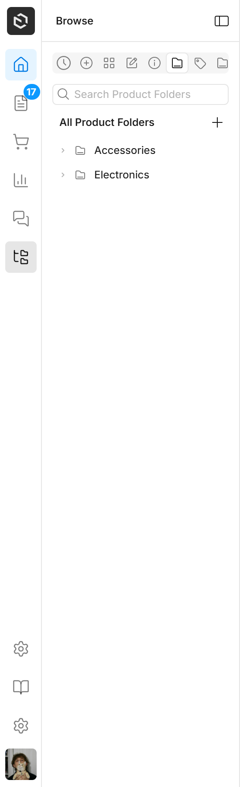

# Migrating to the Payload v4 version

The `beta` releases of this plugin target **Payload `4.0.0-beta`**. The `latest` releases keep supporting Payload v3. This guide covers what changes in the **plugin** when you move a project to Payload v4 — for Payload itself, follow Payload's own [v4 migration guide](https://github.com/payloadcms/payload/blob/main/docs/migration-guide/v4.mdx).

```bash
pnpm add @veiag/payload-enhanced-sidebar@beta
```

## Requirements

| | v3 version | v4 version |
|---|---|---|
| `payload` | `^3.75.0` | `^4.0.0-beta.0` |
| Next.js | 15 | 16.4+ |
| React | 19.2 | 19.3 |
| Node.js | 18.20 / 20.9+ | 24.15+ |
| TypeScript | 5 | 6.0.3+ |

## TL;DR

Most configs keep working unchanged. What you'll notice:

1. Folder/tag trees appear in a new **Browse** tab — Payload v4 reworked folders. → [Native tabs](#native-sidebar-tabs-and-folders)
2. The logout button is gone; the **account menu** (avatar at the bottom) has log out. → [Account menu](#account-menu-and-logout)
3. A **logo** sits at the top of the bar. → [Logo](#logo)
4. The sidebar looks like Payload v4's nav. If you styled it with your own CSS, check the [class changes](#css-and-class-changes).

---

## Native sidebar tabs and folders

Payload v4 replaced folders with **hierarchy collections**: a collection with `folders: true`, `tags: true` or `hierarchy` *is* the folder/tag tree, and Payload adds a sidebar tab with that tree for each one. Projects can also add their own tabs through `admin.components.sidebar.tabs`.

> Note: in Payload v3, `folders: true` meant "documents of this collection can go into folders". In v4 it turns the collection itself into folders. See Payload's guide for setting folders up again (`createFolderField` / `createTagField`).

The plugin shows those tabs through the new [`nativeTabs`](configuration.md#nativetabs) option:



- **`'group'` (default)** — one **Browse** tab (`FolderTree` icon) at the end of the top tabs. Inside, Payload's own tab switcher lists the native tabs, so they keep Payload's look and their icons don't mix with the Lucide icons in the bar. It's added only when there is at least one native tab, and it renders lazily — the trees aren't queried until it's opened. With a single native tab, its content shows directly, with no switcher.
- **`'map'`** — every native tab becomes its own item in the tabs bar, with Payload's icon.
- **`false`** — don't show them.

Customize the Browse tab:

```ts
payloadEnhancedSidebar({
  nativeTabs: {
    id: 'library',                                 // default 'payload-tabs'
    label: { en: 'Library', uk: 'Бібліотека' },   // default 'Browse'
    icon: 'Library',                               // or iconComponent
    position: 'bottom',                            // default 'top'
  },
})
```

The `id` must not clash with your `tabs` ids (the plugin throws if it does).

Things to know:

- A folder/tag collection **disappears from the regular nav** (Payload sets `admin.group: false` on it) unless you give it an `admin.group`. If a tab lists it in `collections`, it won't show there either — it lives in Browse.
- The v3 **"Browse by Folder" button** in the bar is gone: Payload v4 has no browse-by-folder view. The Browse tab replaces it.
- Payload's own "collections" tab is never shown — your tabs replace it.

## Account menu and logout

Payload v4 moved the account menu (profile, theme, language, settings, log out) **into the nav**, and a custom nav has to render it — otherwise the admin has none. The plugin now shows it as an **avatar button at the bottom of the tabs bar**.

- New option [`userMenu`](configuration.md#usermenu) (default `true`). Setting it to `false` leaves the admin without an account menu, so only do it if you render one yourself.
- **`showLogout` now defaults to `false`**: log out is in the account menu, as in Payload's nav. Set `showLogout: true` to keep the separate button.
- `admin.components.userMenuSettingsItems` show up in the account menu's Settings sub-menu. `admin.components.settingsMenu` stays behind the gear button.
- `admin.components.logout.Button` is used as the account menu's log out item.

### Avatars

The avatar follows `admin.avatar` and is drawn as a rounded square, like the other bar buttons:

| `admin.avatar` | Shown |
|---|---|
| `'gravatar'` (Payload's default) | The user's Gravatar; Gravatar's grey silhouette when they have none |
| `'default'` | The user's initial on a brand-colored tile (instead of Payload's round person icon) |
| `{ Component }` | Your component, filling the button |

The same avatar is used in the menu's profile header.

## Logo

New option [`logo`](configuration.md#logo), **on by default**: a 32px tile at the top of the bar, linking to the dashboard. By default it shows `admin.components.graphics.Icon` — which Payload v4 no longer shows anywhere in the admin (it used to be the first breadcrumb) — or the Payload icon.

```ts
logo: false                                          // no logo
logo: './components/Logo#Logo'                       // your component
logo: { container: 'subtle' }                        // default icon, light tile
logo: { component: './components/Logo#Logo', container: 'none' } // your component, no tile
```

`container`:

- `'inverse'` (default) — dark tile in the light theme, light in the dark one. Icons drawn with `--color-icon` or `currentColor` (the Payload icon included) flip with it.
- `'subtle'` — light grey tile, for logos with fixed colors (images, brand SVGs).
- `'none'` — no tile; your component fills the 32px box.

## Closing the sidebar

In v3 Payload's app header had the hamburger that opened and closed the nav. In v4 the header only has the **open** button, and it's hidden while the nav is open — closing lives in the nav. The plugin now has a **panel header** with the open tab's name and a close button built like Payload's header toggle. Nothing to configure.

In Payload's embedded mode the close button and the account menu are hidden, as in Payload's own nav.

## New options

| Option | Default | |
|---|---|---|
| `nativeTabs` | `'group'` | [Native tabs](#native-sidebar-tabs-and-folders) |
| `userMenu` | `true` | [Account menu](#account-menu-and-logout) |
| `logo` | `true` | [Logo](#logo) |
| `iconStrokeWidth` | `1.5` | Stroke width of the Lucide icons in the bar (Lucide's own default is 2; thinner sits closer to Payload's icons). Also `--enhanced-sidebar-icon-stroke-width` in CSS |
| tab `lazy` | `false` | Render a tab's `contentComponent` on demand instead of on every page load — [docs](custom-components.md#lazy-rendering-lazy-true) |

Changed default: `showLogout` `true` → `false`.

## Look

The sidebar follows Payload v4's design (its Figma-based UI):

- **Nav rows** look like Payload's: a rounded highlight on hover, and a selected "pill" (`--color-bg-selected`, bold) instead of the v3 bar on the panel edge.
- **Tabs bar**: white, 8px between items. A tab whose panel is open is **grey**; a link (or linked tab) for the current page is **blue**. No side bar.
- **Badges** use Payload's status colors (`--color-bg-brand`, `-success`, `-warning`, `-danger`) and follow the dark theme. `warning` is yellow with dark text, as in Payload.
- **Content area** has no side padding: rows and groups inset themselves, like in Payload's nav.

## Plugin shape

The plugin is now authored with Payload's `definePlugin` — the call is unchanged (`payloadEnhancedSidebar({ ... })`). It is registered under the slug `'@veiag/payload-enhanced-sidebar'` and runs with `order: 100`, after plugins with the default order. Other plugins can find it and add tabs with `addSidebarTabs` — see [Adding tabs from another plugin](configuration.md#adding-tabs-from-another-plugin).

## Custom components

The props and the component API are unchanged. Things that behave differently:

- **`NavItem`** (default row) renders `<div class="enhanced-sidebar__link-wrapper">` around the link and is **always a link** — on the current page too, with `aria-current="page"` (v3 rendered a `<div>` there).
- **`NavContentShell`**: `--enhanced-sidebar-content-padding-inline` now defaults to **`0`** (was 20px). Custom tab content that relied on the default padding needs its own, e.g. `style={{ '--enhanced-sidebar-content-padding-inline': '16px' }}`.
- **Hooks in your own components**: import router hooks and `Link` from `@payloadcms/ui`, not `next/*` — Payload v4 requirement (`usePathname`, `useRouter`, `useSearchParams`, `PayloadLink` / `Link`).

## CSS and class changes

The stylesheets are plain CSS now (no SCSS), on Payload v4 tokens: Payload retired the `--theme-*` and `--style-radius-*` variables, so overrides that used them need the new `--color-*` / `--radius-*` tokens.

Removed classes:

| Class | Why |
|---|---|
| `.enhanced-sidebar__link-indicator` | Replaced by the selected pill (`.enhanced-sidebar__link--selected`) |
| `.enhanced-sidebar__header`, `.enhanced-sidebar__mobile-close` | Old close button; see `.enhanced-sidebar__panel-header` |
| `.enhanced-sidebar--nav-animate` | Payload v4 dropped `shouldAnimate`; the fade-in is on `.enhanced-sidebar--nav-hydrated` |

New classes:

- `.enhanced-sidebar__panel`, `__panel-header`, `__panel-title` — the column next to the bar and its header
- `.enhanced-sidebar__link-wrapper`, `.enhanced-sidebar__link--selected` — nav rows
- `.tabs-bar__top`, `.tabs-bar__logo`, `.tabs-bar__logo-tile` (`--inverse` / `--subtle` / `--none`) — the logo
- `.enhanced-sidebar-user`, `__avatar`, `__initial` — the account menu button

Changed: `.tabs-bar__link--active` and `.tabs-bar__tab--current` are a blue tint now (no `::before` bar); `.tabs-bar__tab--active` is grey.
